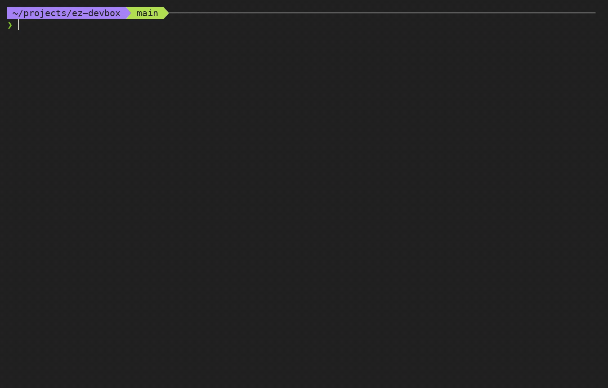

# 🤖 ez-devbox 📦

[](https://www.npmjs.com/package/ez-devbox)
[](https://github.com/shanebishop1/ez-devbox/actions/workflows/ci.yml)
[](https://github.com/shanebishop1/ez-devbox/blob/main/LICENSE)

`ez-devbox` runs coding agents in disposable [E2B](https://e2b.dev) sandboxes. It clones your repos, syncs selected tool config and credentials, and lets you reconnect to persistent sessions.



## Features

- Launch and reconnect to OpenCode, Codex, Claude Code, a configured custom terminal agent, or a shell.
- Clone repos, check out branches, and run setup commands from TOML configuration.
- Forward selected environment variables and sync local tool auth/config.
- Reach local MCP servers, Docker containers, or other services through optional tunnels.

## Demo flow

After the [Quick start](#quick-start), with Node.js 20+, an `E2B_API_KEY` in `.env`, and an `ez-devbox.config.toml` in the current directory:

```bash
npx ez-devbox@latest create --mode ssh-opencode --detach --json
# Set SANDBOX_ID to the sandboxId from the create result.
npx ez-devbox@latest resume
npx ez-devbox@latest list --json
npx ez-devbox@latest wipe --sandbox-id "$SANDBOX_ID"
```

## Modes and guides

- `ssh-opencode`: attach the OpenCode TUI to a persistent in-sandbox `opencode serve` backend.
- `ssh-codex` / `ssh-claude`: attach the CLI inside a persistent `tmux` session.
- `ssh-custom`: launch the configured `[agent].command` in a compatible template and `tmux` session.
- `web`: start `opencode serve` and print a browser URL.
- `ssh-shell`: attach an interactive shell in a persistent `tmux` session.

See the [SSH agent modes guide](docs/modes-ssh-agents.md), [web mode guide](docs/modes-web.md), [agent and automation guide](docs/agent-automation.md), and [configuration reference](docs/launcher-config-reference.md). Web mode requires a nonempty `OPENCODE_SERVER_PASSWORD` when it starts a new public listener.

## Install

Prerequisites:

- Node.js 20 or newer on macOS or Linux. Windows config paths are supported, but Windows host SSH/tunnel workflows are not currently tested in CI.
- An [E2B API key](https://e2b.dev/docs/getting-started/api-key).
- `ssh` for SSH modes. If `tmux` is missing in the E2B template, ez-devbox installs it with `apt-get` or `apk`; other templates must provide it. Docker or `cloudflared` is needed only for tunnel features.
- An `ez-devbox.config.toml`, created from the example or by the interactive first-run prompt.

Choose one:

```bash
npm install --save-dev ez-devbox
npx ez-devbox --help
```

Or run one-off with `npx ez-devbox --help`, or install globally with `npm install -g ez-devbox` and use `ez-devbox --help`. The package installs both `ez-devbox` and its shorter `ezdb` alias.

## Environment variables

Set variables in your shell or a local `.env` file. For a source checkout:

```bash
cp .env.example .env
```

Required for real sandbox operations:

- `E2B_API_KEY`

Common optional variables:

- `FIRECRAWL_API_URL`: available to your own sandbox tooling, such as tunneled MCP/API endpoints.
- `FIRECRAWL_API_KEY`: forwarded only when listed in `env.pass_through`.
- `GITHUB_TOKEN` / `GH_TOKEN`: used by GitHub auth flows, especially when `[gh].enabled = true`.
- `OPENCODE_SERVER_PASSWORD`: used for new authenticated web listeners.

Do not commit `.env`; it contains local secrets.

## Quick start

1. Create `.env` and set at least:

   ```bash
   printf 'E2B_API_KEY=%s\n' 'your_key_here' > .env
   ```

2. Download the complete minimal config, then edit its repo URL, branch, and setup command:

   ```bash
   curl -fsSLo ez-devbox.config.toml \
     https://raw.githubusercontent.com/shanebishop1/ez-devbox/main/examples/minimal/ez-devbox.config.toml
   ```

   The same example is shipped in `node_modules/ez-devbox/examples/minimal/ez-devbox.config.toml`. See the [minimal workflow](examples/minimal) for a runnable public-repo example.

   Config lookup is local-first: `./ez-devbox.config.toml`, then the global user file at `~/.config/ez-devbox/ez-devbox.config.toml` on macOS/Linux or `%APPDATA%\\ez-devbox\\ez-devbox.config.toml` on Windows. In an interactive terminal, missing files trigger a starter-config prompt; non-interactive runs report both expected paths.

3. Run:

   ```bash
   npx ez-devbox create
   npx ez-devbox connect
   ```

For every configuration field, see the [configuration reference](docs/launcher-config-reference.md).

## Common commands

Use `npx ez-devbox ...` if the CLI is not globally installed.

| Goal | Command |
| --- | --- |
| Help | `ez-devbox --help` |
| Create and launch | `ez-devbox create --mode web` |
| List sandboxes | `ez-devbox list` |
| Connect to a sandbox | `ez-devbox connect --sandbox-id <sandbox-id>` |
| Resume the last sandbox/mode | `ez-devbox resume` |
| Run a command in a sandbox | `ez-devbox command --sandbox-id <sandbox-id> -- pwd` |
| JSON output | `ez-devbox list --json` |
| Start detached | `ez-devbox create --mode ssh-codex --detach --json` |
| Send a follow-up | `ez-devbox connect --sandbox-id <id> --mode ssh-codex --detach --prompt-file follow-up.md --json` |
| Wipe one sandbox | `ez-devbox wipe` |
| Wipe all sandboxes | `ez-devbox wipe-all --yes` |

`--json` provides machine-readable output for `list`, `command`, `create`, and `connect`; optional fields such as `url` are omitted for SSH modes. See [agent and automation usage](docs/agent-automation.md) for result fields, detached startup, prompt transport, non-PTY inspection, and concurrency.

Use `--verbose` with `create` or `connect` for detailed startup, sandbox, bootstrap, SSH, and tunnel logs.

## Credentials, tunnels, and lifecycle

- `E2B_API_KEY` stays on the host for the E2B SDK. Built-in forwarding and `[env].pass_through` values enter the sandbox during creation and may also be supplied to setup/startup commands on reconnect.
- Tool auth/config sync is explicit and create-time only. Synced OpenCode, Codex, Claude, and optional GitHub CLI files make the sandbox credential-bearing; use trusted templates and repositories.
- Cloudflare quick tunnels provide public HTTPS URLs, not private sandbox-only access. Anyone with a URL can reach the forwarded service while the CLI operation and tunnel process are active. ez-devbox does not add tunnel authentication; enforce auth in the upstream service, treat URLs as secrets, and do not expose unauthenticated sensitive endpoints.
- Sandboxes are not deleted when you detach or exit. `sandbox.timeout_ms` sets the E2B timeout at creation, reconnecting does not reset it, and the reserved `reuse` and `delete_on_exit` fields do not change lifecycle behavior. Use `wipe --sandbox-id <id>` or `wipe-all --yes` for explicit cleanup.

For remote tunnel targets and all tunnel field details, see the [configuration reference](docs/launcher-config-reference.md#tunnel).

## Troubleshooting

- `authorization header is missing` / 401: check that `.env` exists and contains `E2B_API_KEY`.
- `wipe-all requires --yes in non-interactive terminals`: add `--yes` in CI or scripts.
- Multiple sandboxes in a non-interactive run: pass `--sandbox-id <id>` explicitly.
- Tunnel command issues: install `cloudflared`, or ensure Docker is available for fallback.

## Contributing

- Security reports: [SECURITY.md](SECURITY.md)
- Contributions: [CONTRIBUTING.md](CONTRIBUTING.md)
- Release notes: [CHANGELOG.md](CHANGELOG.md)
